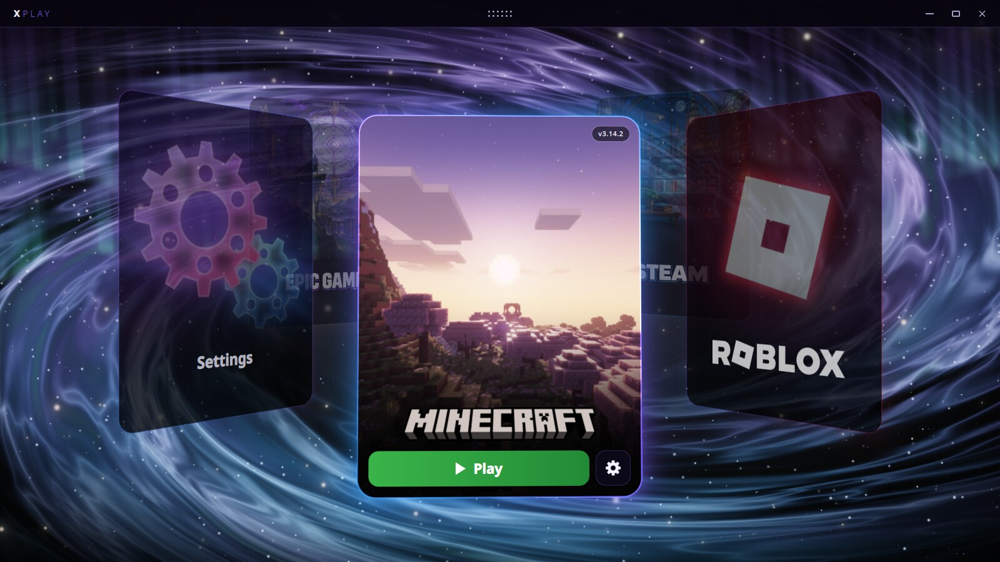
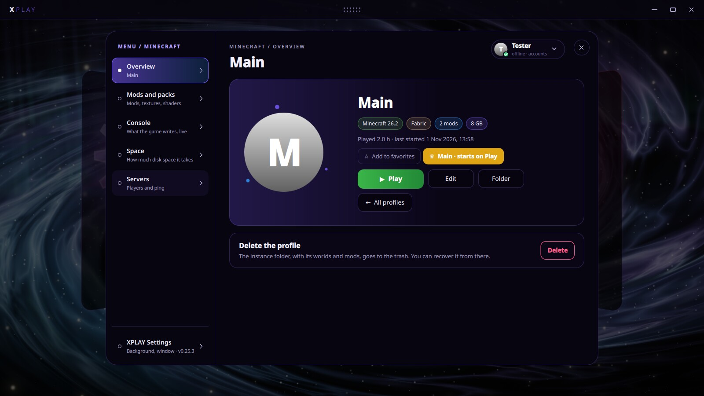
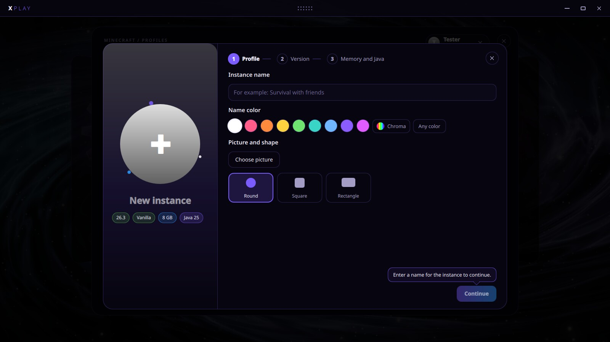
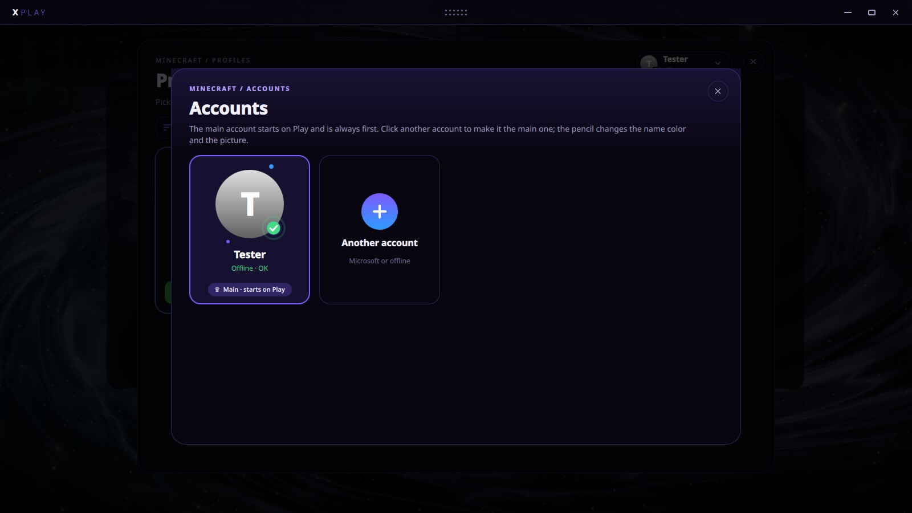
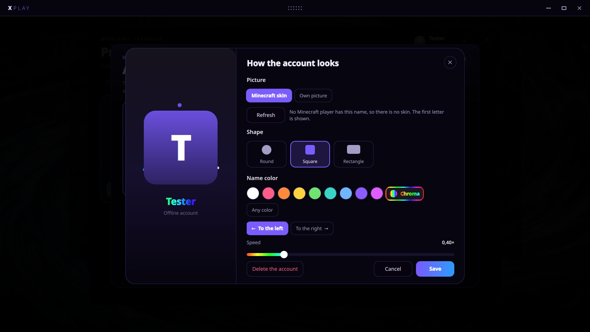
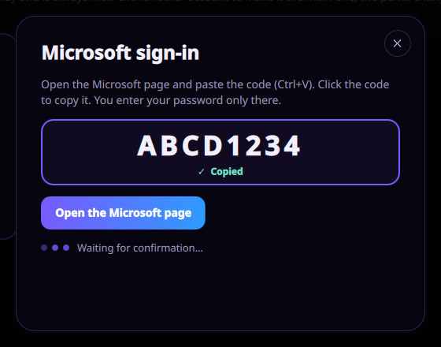

<div align="center">


# XPlay

**A modular game launcher for Linux.** Minecraft, Roblox, Steam and Epic Games in one place.

[](https://github.com/asygames/xplay-releases/releases)


[Download](https://github.com/asygames/xplay-releases/releases) · [Features](#features) · [Microsoft sign-in](#microsoft-sign-in-for-minecraft) · [Privacy](PRIVACY.md)



</div>

## About

XPlay is an independent game launcher for Linux made by **AsyGames**. Each game is a card on an orbit over an animated background. Spin the orbit to choose a game, press **Play** to start it, or open the game's menu from the gear button.

Each game integration is a separate module, so it can be updated without touching the rest of the launcher. XPlay ships as a single **AppImage** that contains Qt, the X11 and Wayland plugins and every game module.

## Features

| | |
| --- | --- |
| **Minecraft: Java Edition** | Runs directly from XPlay, with no other launcher needed. Microsoft or offline accounts, profiles, Vanilla, Fabric, Quilt, Forge and NeoForge, Java downloaded automatically, mods and modpacks from Modrinth, shaders, a game console, servers with ping, and a crash page that explains why the game stopped. |
| **Roblox** | Several Roblox accounts side by side, each as its own instance. A game library with favorites, search by name, Place ID or link, and joining a friend. Roblox Studio is supported too. |
| **Steam** | Your library with covers, install and play, favorites, launch options per game and several accounts. The store page shows games that run on Linux. |
| **Epic Games** | Sign-in, downloads and launching handled by XPlay itself, with no extra client. Free games can be added to the library directly. |
| **Settings** | Language (English or Romanian), automatic updates verified against the published SHA-256 sums, five animated background scenes, and colors and a card picture for each game. |

## Screenshots

<table>
  <tr>
    <td width="50%"><br><sub><b>Minecraft profile:</b> version, loader, mods, memory and play time.</sub></td>
    <td width="50%"><br><sub><b>New instance:</b> a three-step wizard (profile, version, memory and Java).</sub></td>
  </tr>
  <tr>
    <td width="50%"><br><sub><b>Accounts:</b> Microsoft and offline accounts; the main one starts on Play.</sub></td>
    <td width="50%"><br><sub><b>Account style:</b> skin or custom picture, shape and name color.</sub></td>
  </tr>
</table>

## Microsoft sign-in for Minecraft



XPlay signs in to Microsoft with the official **device code flow** (OAuth 2.0 device authorization grant). XPlay never sees or stores your Microsoft password.

1. In XPlay, open **Accounts → Another account → Microsoft account**.
2. XPlay shows a short code and copies it for you.
3. Press **Open the Microsoft page**, paste the code and sign in on Microsoft's own page.
4. XPlay receives the authorization, checks that the account owns Minecraft: Java Edition and adds the player profile.

The tokens are used only to sign in to Microsoft, Xbox Live and Minecraft services and to start the game. They stay on your computer in an AES-256-GCM encrypted file. XPlay does not bypass game ownership or any other service requirement.

Details: [Privacy and authentication](PRIVACY.md).

<br clear="right">

## Install

Download `XPlay-<version>-x86_64.AppImage` from [Releases](https://github.com/asygames/xplay-releases/releases), check it and run it:

```sh
sha256sum -c XPlay-*-x86_64.AppImage.sha256
chmod +x XPlay-*-x86_64.AppImage
./XPlay-*-x86_64.AppImage
```

On first start XPlay adds itself to the application menu. It needs a Linux desktop (X11 or Wayland), a graphics driver and glibc 2.43 or newer.

| Control | Action |
| --- | --- |
| Drag, mouse wheel, `←` `→` | Spin the cards |
| **Play** or `Enter` | Start the game in front |
| Gear button or `S` | Open the game's menu |
| `F11` | Full screen |
| `F3` | FPS, RAM and VRAM |

## About this repository

This repository is XPlay's public overview and the reference for the Microsoft and Minecraft authentication review. The source code is kept in a private repository. Builds are published in [asygames/xplay-releases](https://github.com/asygames/xplay-releases/releases).

## Publisher

**AsyGames** · [github.com/asygames](https://github.com/asygames)

## Disclaimer

XPlay is an independent third-party application. It is **not affiliated with, endorsed by or sponsored by** Microsoft, Mojang Studios, Roblox Corporation, Valve or Epic Games. Minecraft, Roblox, Steam, Epic Games and the related names and logos are trademarks of their respective owners. The screenshots use test accounts.
